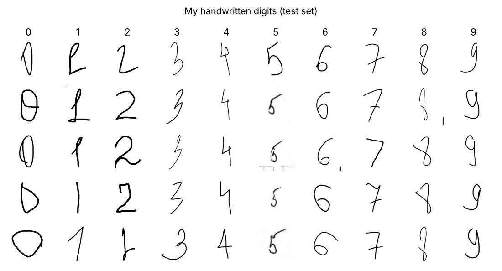
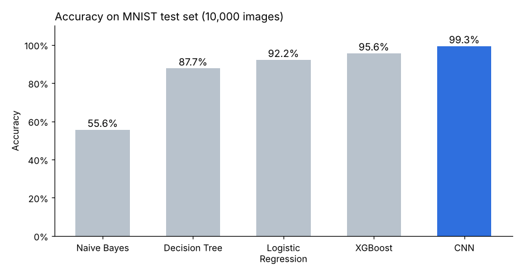
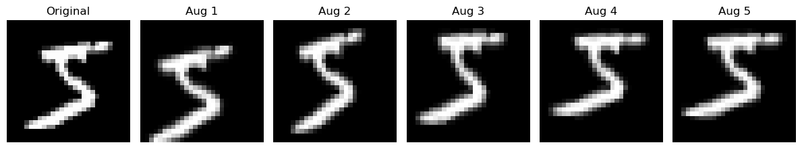

# Handwritten Digit Recognition (MNIST)

Machine learning assignment: classify handwritten digits (0–9).
I trained several classical ML models and a CNN on **MNIST**, then tested them on **101 digits that I wrote myself**.



## Results

### MNIST test set (10,000 images)

| Model | Accuracy | Precision | Recall | F1-score |
|---|---|---|---|---|
| Naive Bayes | 0.5558 | 0.6917 | 0.5558 | 0.5170 |
| Decision Tree | 0.8770 | 0.8768 | 0.8770 | 0.8769 |
| Logistic Regression | 0.9216 | 0.9215 | 0.9216 | 0.9215 |
| XGBoost | 0.9558 | 0.9559 | 0.9558 | 0.9558 |
| **CNN** | **0.9934** | **0.9934** | **0.9934** | **0.9934** |



### My own handwritten digits (101 images)

| Model | Accuracy | Precision | Recall | F1-score |
|---|---|---|---|---|
| XGBoost | 0.0200 | 0.0074 | 0.0200 | 0.0106 |
| **CNN** | **0.7921** | **0.8148** | **0.7921** | **0.7801** |

Precision, recall and F1 are weighted averages over the 10 classes.

## What I learned

- **CNN is the best model.** It learns shapes (lines, curves, loops), not single pixels. It reaches 99.3% on MNIST.
- **Real handwriting is harder than MNIST.** The CNN drops from 99.3% to 79.2% on my digits. My photos have different thickness, position, size and lighting.
- **Data augmentation helps.** Random rotation, shift and zoom make the training data more like real handwriting.
- **Preprocessing must match.** MNIST is a white digit on a black background. My photos are a dark digit on a white background, so they must be inverted. XGBoost got only 2% on my digits because the colors of training and new images did not match.



## Methods

**Classical models** — each image is resized to 28×28 grayscale, scaled to [0, 1] and flattened into 784 features.

- Logistic Regression (with StandardScaler)
- Gaussian Naive Bayes
- Decision Tree
- XGBoost (100 trees, max depth 4)

**CNN**

```
Input 28×28×1
→ Conv2D(32, 3×3, ReLU) → MaxPooling(2×2)
→ Conv2D(64, 3×3, ReLU) → MaxPooling(2×2)
→ Flatten → Dense(128, ReLU) → Dropout(0.4)
→ Dense(10, softmax)
```

Optimizer: Adam (lr = 0.001), batch size 128, up to 15 epochs with early stopping (patience = 3).
Augmentation: rotation ±10°, width/height shift 10%, zoom 10%.

## Project structure

```
mnist-digit-recognition/
├── notebooks/
│   └── mnist_digit_recognition.ipynb   # all code and results
├── data/
│   ├── handwritten_digits/             # my 101 handwritten digits, one folder per class
│   └── mnist_png/                      # MNIST (not included, download it)
├── images/                             # pictures for this README
├── requirements.txt
└── README.md
```

## How to run

1. Clone the repository:
   ```bash
   git clone https://github.com/<your-username>/mnist-digit-recognition.git
   cd mnist-digit-recognition
   ```
2. Install the libraries:
   ```bash
   pip install -r requirements.txt
   ```
3. Download MNIST as PNG files (search "MNIST PNG" on Kaggle) and put it here:
   ```
   data/mnist_png/train/0 ... 9
   data/mnist_png/test/0 ... 9
   ```
4. Open `notebooks/mnist_digit_recognition.ipynb` and run all cells.

## Tools

Python · NumPy · pandas · Pillow · scikit-learn · XGBoost · TensorFlow / Keras · Matplotlib
